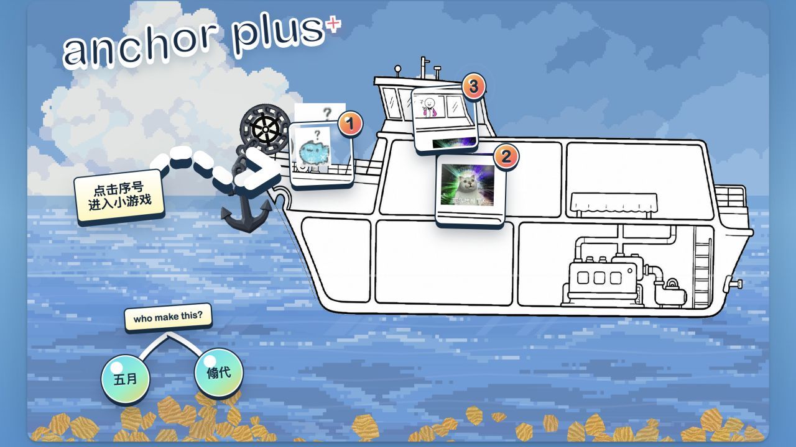
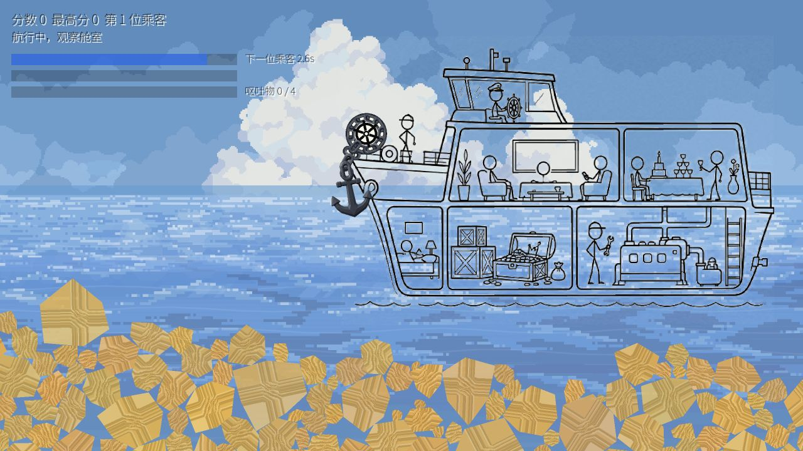
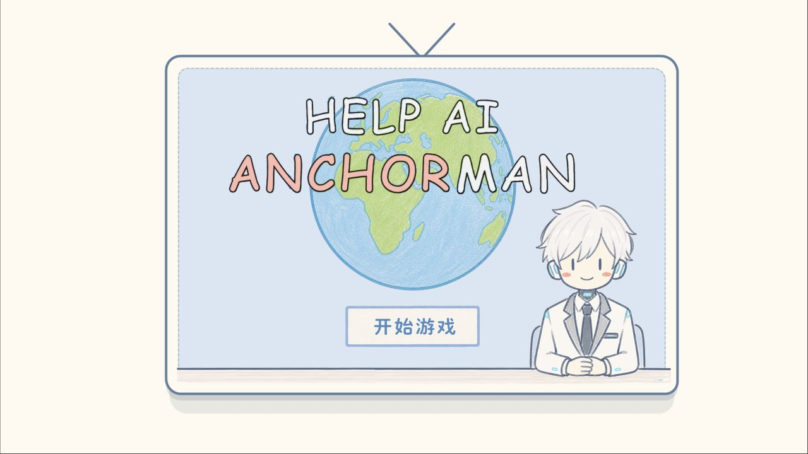
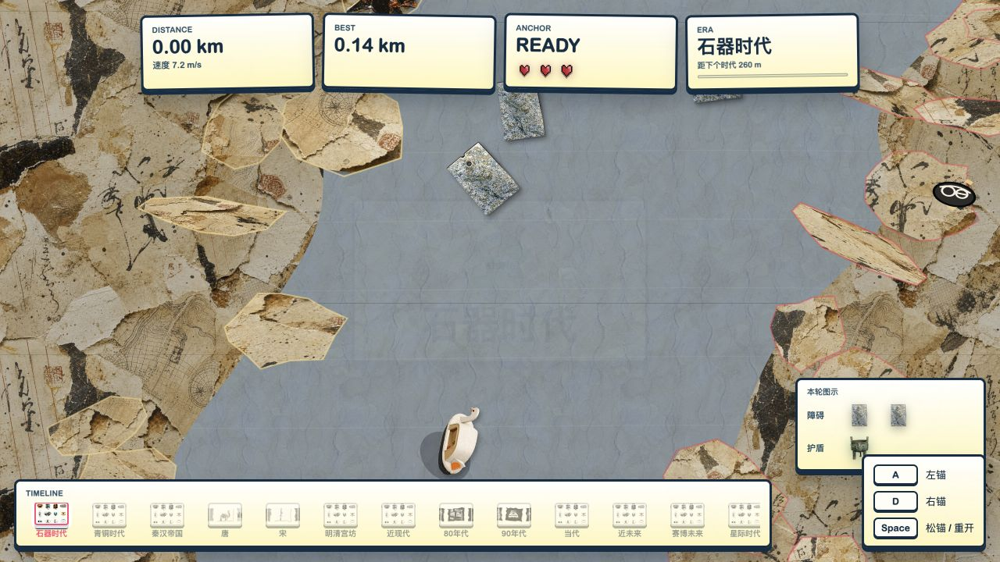

# CiGA 2026 · Anchor Plus+

三个围绕“锚”的小游戏：有人在船上快吐了，有个 AI 主播需要帮忙，还有一条可以一路划过不同时代的河。

这个仓库收集了 CiGA 2026 期间的游戏、网页原型和美术迭代。当前总入口是 **Anchor Plus+**，保留手绘、像素海洋和拼贴素材混在一起的样子。署名沿用游戏入口中的 **五月 / 翛代**。



[三个小游戏](#1-三个小游戏) · [本地运行](#2-本地运行) · [项目结构](#3-项目结构) · [整理记录](docs/CONSOLIDATION.md)

## 1. 三个小游戏

### 01 · 有人要吐了，，

乘客会陆续晕船，需要在合适的时机抛锚，让船减速。没处理好的乘客会留下呕吐物；船舱堆满后，这一局就结束了。



**操作：** 时机条出现时按 `Space` 抛锚；游戏结束后按 `Enter` 重开。

**源码：** [games/anchorshackeshacke](games/anchorshackeshacke/) · Godot 4.7。场景、船体、锚链、沙石和晕船逻辑分别保留在项目自己的 `scenes/`、`scripts/` 和 `assets/` 中。

### 02 · Help AI Anchorman

一个需要你帮忙的 AI 主播。先看开场漫画，再进入直播间，根据情境操作界面里的时钟、表情和确认按钮。



**操作：** 鼠标点击开始、阅读漫画和操作直播间；具体交互跟随游戏画面提示。

**源码：** [games/help-ai-anchorman](games/help-ai-anchorman/) · Godot 4.7。网页实现也保留了[后期 H5 版本](web/anchorman/)和[早期 H5 版本](archive/anchorman-h5-v1/)，它们是开发过程中的不同实现，不等同于 Godot 版本。

### 03 · 梅人说不能做跑酷 / Anchor Drift

用左右船锚把小船甩过河道，避开岸边和障碍物。路程增加后，环境会从石器时代切换到后面的时代，画面中的物件和拼贴素材也随之变化。



**操作：** `A` 左锚，`D` 右锚，`Space` 松开当前锚；开始与结束页面也有按钮提示。

**源码：** [web/index.html](web/index.html)、[web/game.js](web/game.js) 和 [web/assets](web/assets/) · HTML / CSS / JavaScript。

> 上面四张图均来自本仓库当前版本的浏览器运行截图：总入口、两个 Godot Web 导出和河流网页游戏。

## 2. 本地运行

需要 **Python 3**。导出前两个小游戏还需要 **Godot 4.7** 和与它版本一致的 **Web 导出模板**。

```bash
git clone git@github.com:acciomerlin/ciga-2026.git
cd ciga-2026

# 把路径换成自己的 Godot 可执行文件
python3 tools/export_web.py --godot /path/to/Godot
python3 tools/serve.py
```

macOS 的 Godot 路径通常类似 `/Applications/Godot.app/Contents/MacOS/Godot`。如果已加入 PATH，也可直接执行 `python3 tools/export_web.py`。

打开 **<http://127.0.0.1:8080/>**，从序号入口进入游戏。

| 本地页面 | 地址 |
| --- | --- |
| 三个小游戏总入口 | <http://127.0.0.1:8080/> |
| 晕船抛锚 | <http://127.0.0.1:8080/dist/anchorshackeshacke/> |
| AI 主播 Godot 版 | <http://127.0.0.1:8080/dist/help-ai-anchorman/> |
| 年代河流跑酷 | <http://127.0.0.1:8080/web/index.html> |
| AI 主播 H5 版 | <http://127.0.0.1:8080/web/anchorman/> |

`dist/` 是本地生成的导出目录，不提交到 Git。刚克隆的仓库需要先导出，前两个入口才会有内容。没有 Godot 时，仍可启动服务器查看河流游戏、H5 主播版本和网页原型。

不要直接双击 Godot 导出的 HTML；浏览器需要通过 HTTP 加载 `.wasm` 和 `.pck`。上面的地址都是本机预览地址，上传 GitHub 仓库不会自动发布在线游戏。

用 Godot 编辑时，分别导入 `games/` 下的 `project.godot`。`anchorshackeshacke`、`help-ai-anchorman` 当前用 Godot 4.7 验证；`throw-anchor` 保留原项目的 Godot 4.6 配置。

## 3. 项目结构

```text
ciga-2026/
├── games/                       Godot 游戏源码
│   ├── anchorshackeshacke/       晕船、抛锚与沙石
│   ├── help-ai-anchorman/        AI 主播
│   └── throw-anchor/            抛个锚 3D 原型
├── web/                         总入口、河流游戏及主播 H5 版
├── prototypes/                  船体、链条、物理与 3D 白盒实验
├── art/anchorman-iterations/    主播美术迭代、切图
├── archive/anchorman-h5-v1/     早期主播 H5 版本
├── docs/                        运行截图、统计与迁移记录
├── licenses/                    字体授权
└── tools/                       导出、运行与检查脚本
```

开发过程中的实验也留着，可以分别查看：[船体与物理网页原型](prototypes/ship-web/)、[Godot 3D 抛锚原型](prototypes/godot-anchor-3d/)和[河道白盒](prototypes/anchor-river-whitebox-4.3/)。它们代表不同阶段的尝试，不都是总入口中的最终玩法。

主播的表情、手势、地球、时钟和文字切图保存在 [art/anchorman-iterations](art/anchorman-iterations/)；河流游戏的时代素材及来源记录在 [web/assets](web/assets/)。

## 4. 整理与验证

仓库由原来的 `ciga`、`ciga_2`、`ciga-3` 整理而来。原文件约 **1.162 GB**，整理后的源码工作区约 **271 MB**；原始目录仍完整保留。

合并了两份完全相同的“抛个锚”源码，保留有差异的 H5 版本和美术迭代。旧 Git 历史、编辑器缓存、ZIP 和 Web 导出没有带进新仓库。容量、目录映射及处理规则见 [整理记录](docs/CONSOLIDATION.md)，逐文件来源及原始校验值见 [迁移清单](docs/source-manifest.json)。

```bash
python3 tools/check_workspace.py
```

检查脚本会核对静态资源路径、源文件大小，并在安装 Node.js 时检查自有 JavaScript 的语法。两个 Godot 项目已做 Web 导出和启动检查；本地 HTTP 检查记录在 [docs/verification.json](docs/verification.json)。这些检查不等于完整人工通关测试。

## 5. 来源与使用范围

保留原有素材的来源记录及第三方声明，见 [THIRD_PARTY_NOTICES.md](THIRD_PARTY_NOTICES.md)。Noto 字体的授权文本放在 [licenses](licenses/)。

目前仓库为私有，没有给整个游戏新增开源许可证；代码、美术、角色和第三方素材的使用范围仍需分别确认。
