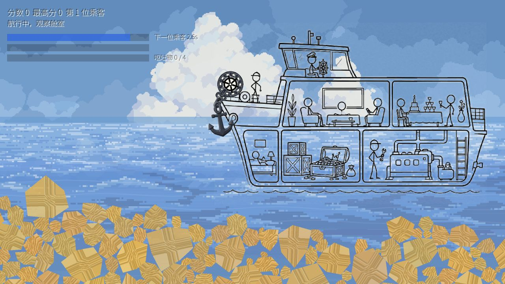

# 01 · 有人要吐了，，

乘客晕船，船还在走。看准时机抛锚，让船减速，别让呕吐物堆满船舱。



## 1. 玩哪个版本

[godot](godot/) 是 Anchor Plus+ 序号 1 使用的游戏源码。时机条出现时按 `Space` 抛锚，游戏结束后按 `Enter` 重开。游戏逻辑、画面、素材和项目内部目录未在这次整理中重写。

在仓库根目录执行：

```bash
python3 tools/export_web.py --game anchorshackeshacke --godot /path/to/Godot
python3 tools/serve.py
```

打开 <http://127.0.0.1:8080/dist/anchorshackeshacke/>。编辑源码时，用 Godot 4.7 导入 `godot/project.godot`。

## 2. 开发过程也留着

| 位置 | 内容 |
| --- | --- |
| [godot/scenes](godot/scenes/) | 当前游戏场景 |
| [godot/scripts](godot/scripts/) | 船体、乘客、锚链、沙石等逻辑 |
| [godot/assets](godot/assets/) | 当前游戏使用的美术、字体和其他资源 |
| [prototypes/web](prototypes/web/) | 船体网页原型、概念图、背景尝试和预览图 |
| [物理实验](prototypes/web/physics-matter-test.html) | Matter.js 实验 |
| [抛链实验](prototypes/web/chain-throw-test.html) | 锚链交互实验 |
| [3D 物理实验](prototypes/web/physics-three-test.html) | Three.js 实验 |
| [早期接入记录](docs/history/README_GAME1_INTEGRATION.md) | 当时导出和接入菜单的操作记录，旧绝对路径仅供历史参考 |

这些原型不替代当前游戏，也不代表都已经完成。它们原有的资源和第三方依赖一并保留。

[返回三个小游戏](../../README.md) · [目录重组记录](../../docs/REORGANIZATION.md)
