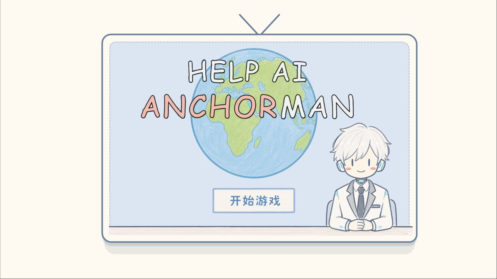

# 02 · Help AI Anchorman

一个需要你帮忙的 AI 主播。看开场漫画，进入直播间，再根据情境操作时钟、表情和确认按钮。



## 1. 玩哪个版本

[godot](godot/) 是 Anchor Plus+ 序号 2 使用的游戏源码，用鼠标点击操作。保留原来的场景、脚本、字体和素材，整理不改变游戏内容。

在仓库根目录执行：

```bash
python3 tools/export_web.py --game help-ai-anchorman --godot /path/to/Godot
python3 tools/serve.py
```

打开 <http://127.0.0.1:8080/dist/help-ai-anchorman/>。编辑源码时，用 Godot 4.7 导入 `godot/project.godot`。

## 2. 不同实现分别保留

| 位置 | 内容与运行方式 |
| --- | --- |
| [godot](godot/) | 当前 Godot 实现，导出到仓库根目录 `dist/help-ai-anchorman/` |
| [web](web/) | 较后期的 H5 实现，启动服务器后打开 `/games/02-ai-anchorman/web/` |
| [history/web-v1](history/web-v1/) | 较早的 H5 实现，启动服务器后打开 `/games/02-ai-anchorman/history/web-v1/` |
| [art/iterations](art/iterations/) | 角色、表情、手势、地球、时钟、边框和文字切图的开发迭代 |

两个 H5 版本都保留 `admin.html` 及各自素材；它们之间有差异，也不与 Godot 实现强行合并。美术迭代保持原文件名，避免与当前游戏使用的资源混淆。

## 3. 美术迭代

下面是开发时留下的时钟预览，不是新画的素材，也不是当前游戏截图。


[时钟拆件](art/iterations/game_clock_assets/) · [边框](art/iterations/game_frame_assets/) · [文字切图](art/iterations/extracted_text_assets/)

[返回三个小游戏](../../README.md) · [目录重组记录](../../docs/REORGANIZATION.md)
