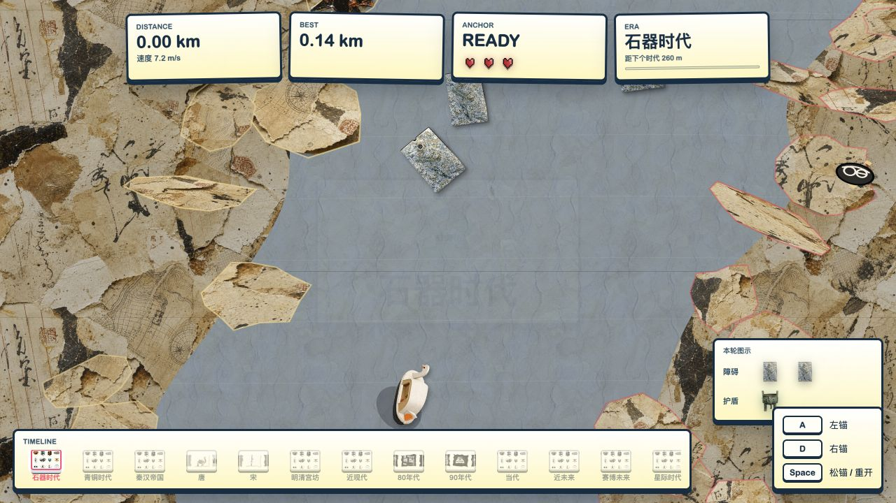

# 03 · 梅人说不能做跑酷 / Anchor Drift

用左右船锚把小船甩过河道，绕过岸边和障碍物。路程增加后，时代和拼贴素材随之变化。

## 1. 玩哪个版本

[web](web/) 是 Anchor Plus+ 序号 3 使用的河流游戏。`A` 左锚，`D` 右锚，`Space` 松开当前锚；开始与结束页面也有按钮提示。

不需要导出。在仓库根目录执行 `python3 tools/serve.py`，打开 <http://127.0.0.1:8080/games/03-anchor-drift/web/>。

| 位置 | 内容 |
| --- | --- |
| [web/index.html](web/index.html) | 当前网页入口 |
| [web/game.js](web/game.js) | 原有游戏逻辑，本次整理未改动 |
| [web/styles.css](web/styles.css) | 原有页面样式，本次整理未改动 |
| [web/assets](web/assets/) | 时代拼贴、船、锚、河岸、障碍物，以及素材来源和生成记录 |

## 2. 原型按尝试保留

| 位置 | 当时在尝试什么 | 运行 |
| --- | --- | --- |
| [透视网页原型](prototypes/web/perspective.html) | 透视河道、左右抛链、障碍物 | 本地服务器打开该 HTML |
| [Three.js 原型](prototypes/web/three-anchor.html) | 3D 环形河道、抛锚和梦境/现实状态 | 本地服务器打开该 HTML，需要联网加载原有 Three.js 依赖 |
| [anchor-runner-godot](prototypes/anchor-runner-godot/) | 自动前进、蓄力抛锚、绕锚转弯与河道障碍物 | Godot 导入该目录的 `project.godot`，原配置为 4.6 |
| [anchor-river-3d](prototypes/anchor-river-3d/) | 3D 水流、抛锚、下沉、挂锚与绳索受力 | Godot 导入该目录的 `project.godot`，原配置为 4.7 |
| [anchor-river-whitebox-4.3](prototypes/anchor-river-whitebox-4.3/) | 另一份河道白盒实现 | Godot 导入该目录的 `project.godot`，保留 4.3 配置 |

原型代表开发过程，不都等于当前正式玩法，也不保证已经完成。网页原型共用 [web/assets](web/assets/) 中的原有资源，不复制或删减素材。原先就存在的缺图引用和联网依赖不在这次目录整理中替换或补画，具体见[目录重组记录](../../docs/REORGANIZATION.md)。

[返回三个小游戏](../../README.md) · [Godot 跑酷原型的开发说明](prototypes/anchor-runner-godot/docs/anchor_runner_architecture.md)
