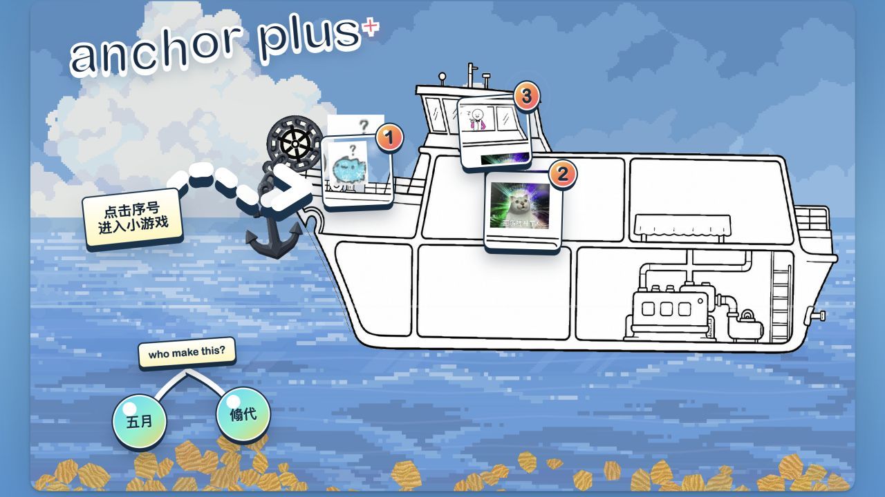

# Anchor Plus+ 总入口

`index.html`、`anchor-plus3.css` 和 `assets/anchor-plus3/` 一起组成原来的序号菜单。画面、文字和素材保持不变，只修正了序号 3 的相对路径。

在仓库根目录运行 `python3 tools/serve.py`，打开 <http://127.0.0.1:8080/>。

序号 1、2 仍分别加载根目录 `dist/anchorshackeshacke/` 和 `dist/help-ai-anchorman/` 的 Godot 导出；序号 3 加载 [河流网页游戏](../games/03-anchor-drift/web/)。前两个游戏需要先运行 `tools/export_web.py` 导出。

[三个游戏与运行方法](../README.md) · [目录重组记录](../docs/REORGANIZATION.md)
